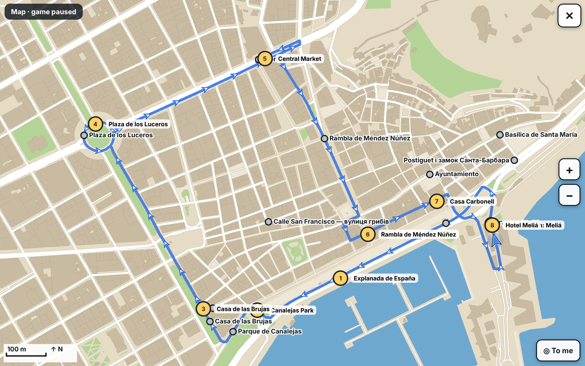
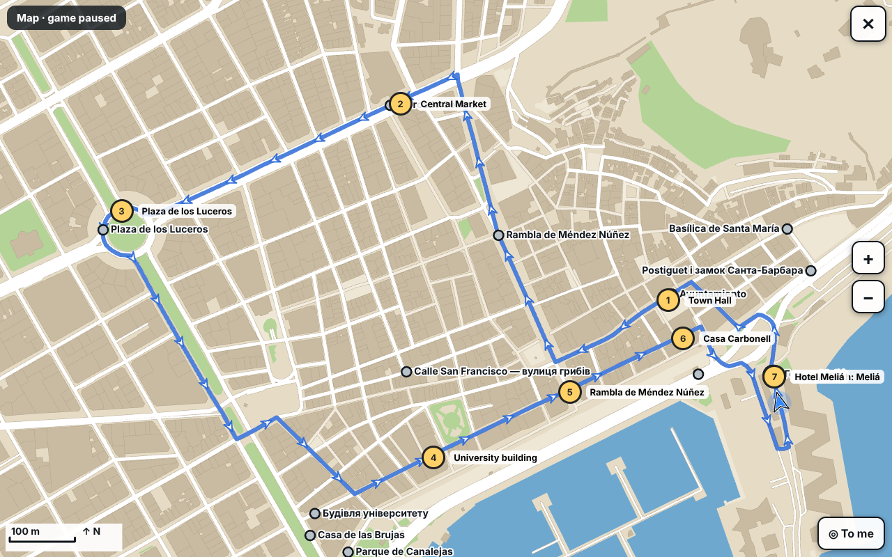

# План: синхронізація з TukTuk OS і рівень Crazy Tuk «Центр»

Дата: 2026-10-11. Стан гри: 0.19.3. **Код не пишу, поки не погодиш.** Усе нижче перевірено на самих даних TukTuk OS і на карті гри; числа з розрахунків, не з пам'яті.

## 0. Коротко

1. **Доступ до TukTuk OS є** (лише читання, GitHub, приватний репозиторій `archigreen55-prog/TukTuk-OS`). Я його склонував і прочитав.
2. **Свіжі дані лежать НЕ в `main`, а в гілці `feat/route-preview`** (`db6660f`): точки, тексти, лінії, фото, значки. У `main` їх нема. Поки гілку не змерджено, синхронізуватись треба з неї.
3. **Гра відстала від TukTuk OS у п'яти речах:** координати (Meliá у грі на 160 м від твоєї точки, Rambla на 260 м, університет на 200 м), тексти (у грі 13 заглушок «ЗАГЛУШКА» + мої чернетки на 70 символів; в TukTuk OS 20 справжніх текстів по ~1000 знаків із запитаннями й джерелами), значки (у грі сірі кружечки; в TukTuk OS 20 власних ілюстрацій), фото (у грі на картці фото нема), перелік турів.
4. **Англійської в TukTuk OS нема зовсім** (лише `uk`). Переклад роблю я, покажу окремим списком на перевірку.
5. **Одна команда** `node tools/sync-tuktuk-os.mjs` підтягує все, показує, що змінилось в TukTuk OS, які переклади застаріли, і перебудовує дані гри.
6. **Рівень «Центр»:** два варіанти, обидва без підйому на замок, максимальний ухил 8.7 %, без повторного проїзду тих самих вулиць. Варіант A: 3.8 км, 8 воріт, орієнтовно 3:50. Варіант B: 3.3 км, 7 воріт, орієнтовно 3:15. Скріни карт нижче. **Моя рекомендація: A.**
7. **Старі рівні:** не видаляти; «Короткий тур» лишити, «До замку» і «Повний тур» сховати в групу «Складні», за замовчуванням вибирати «Центр».
8. **Час:** ≈ 17–22 год у трьох версіях (розділ 8).

## 1. Доступ і звідки брати дані

| | |
|---|---|
| Репозиторій | `archigreen55-prog/TukTuk-OS`, приватний. У цій сесії підключений на читання, `git clone --depth 1` працює (перевірено) |
| `main` | `1a0e78a`: застосунок, міграції, документи, але **без** `points.json`, текстів, фото, ліній маршруту |
| `feat/route-preview` | `db6660f`: **джерело правди для гри**. `client/src/content/routes/alicante-classic/`: `points.json`, `text.uk.json`, `text.stubs.uk.json`, `tours.json`, `route-line.json`, `media.json`, `travel-*.json`; фото й значки в `client/public/media/alicante-classic/<точка>/` |
| Інші гілки з вмістом | `content/poi-drafts` (чернетки текстів, старіші), `claude/tuktuk-os-tour-sync-emwgse` (= попередня версія `feat/route-preview`) |
| Наявний інструмент | `tools/import-tuktuk-os.mjs` (крок 1, 2026-09-28): читає TukTuk OS через `git show <гілка>:<файл>`, пише `data/tour-lines.json`. **Гра цього файлу досі не читає** |

**Питання до тебе (1):** синхронізуватись із `feat/route-preview`, поки її не змерджено в `main`? Я пропоную так, а гілку задати в `data/tuktuk-os-map.json` (`source.ref`). Коли змерджиш, змінимо одне слово.

Про шлях: у файлі відповідностей зараз `~/projects/_ref/TukTuk-OS` (твоя локальна копія). У хмарі такої теки нема, тож команда прийматиме або шлях (`--repo`), або посилання на GitHub (`--clone`, тимчасова неглибока копія). Токен у репозиторій не пишу.

## 2. Що є в TukTuk OS і що зараз у грі

| Що | TukTuk OS (`feat/route-preview`) | Гра (0.19.3) | Чим відрізняється |
|---|---|---|---|
| **Точки** | 26: 20 пам'яток `core`, 6 нових (`melia`, `palmeral` хаби; `estacion`, `diputacion`, `teatro-principal`, `teatro-arniches` `extra`) | 14 місць у `data/tour.json` (+ `castle`, `marq`, `postiguet` за іншою назвою) | У грі нема: Canalejas-ficus, plaza-de-toros, San Antonio, San Fernando, Rico Pérez, ADDA, Palmeral, 4 `extra`. Деякі точки в грі склеєні (Casa Carbonell + Explanada = одне місце `explanada`) |
| **Координати** | твої, з редактора (правки 2026-09-27): Meliá зсунуто на 196 м, Palmeral на 442 м, Rambla на 106 м, ficus на 81 м, станція на 114 м | старі `at` / назви OSM | Розбіжність гра ↔ TukTuk OS: **Meliá 162 м, Rambla 260 м, університет 200 м, Postiguet 210 м**, Canalejas 71 м, Luceros 37 м, інші 20–50 м (гра ставить точку на найближчу дорогу, TukTuk OS на пам'ятку; частину різниці це пояснює, але не Meliá, Rambla й університет) |
| **Назви** | `title` лише українською, з приписками ролі: «Casa Carbonell — старт туру», «Calle San Francisco — …, фініш туру» | українська + англійська `title_en` (мої, 0.19.0) | Приписки «старт» і «фініш» у грі не годяться: ролі залежать від рівня |
| **Значки** | 24 власні ілюстрації `illustration.svg` (20 пам'яток + 4 `extra`; для `melia` і `palmeral` нема; 128×128, разом 31 КБ; статус **prototype**: «лише для порівняння стилів») + `zone` (waterfront, old-town, center, castle, west) + `stopKind` | сірі кружечки з назвою; на повній карті зупинка туру нумерується | Значків у грі нема |
| **Тексти** | на точку: `short` (110–225 знаків), `long` (3–6 абзаців, ~1000 знаків), 3 питання-відповіді, джерела. Усі 20 пам'яток **справжні**. Заглушки («Опис готується») лише в 4 нових `extra`; `melia` і `palmeral` мають короткий опис без `long` | `fact` у `tour.json`: 13 заглушок «ЗАГЛУШКА» + 6 заглушок інтро/аутро; Crazy Tuk показує мої рядки до 70 знаків із `arcade-facts.json` (`uk`, `en`, `es`), складені з відкритих джерел, **не з TukTuk OS** | Тексти TukTuk OS у грі не використовуються взагалі |
| **Англійська** | **нема нічого** (`Lang = 'uk'` у коді) | назви й мої короткі рядки | Усе, що з TukTuk OS, перекладаю я |
| **Фото** | 18 з 20 пам'яток: мініатюра, 640, 960, 1280 px, WebP (версія 640 px: 26–87 КБ, разом 0.85 МБ). **Нема** фото для `plaza-de-toros` і `luceros`; усі фото теж зі статусом prototype. Ліцензії: CC BY-SA 3.0/4.0, CC BY 3.0, CC0; облік у `MEDIA_LICENSES.md` | картка зупинки без фото (лише текст + підпис «фото фасаду» для текстур будинків) | Фото не використовуються. CC BY-SA вимагає підпису автора на екрані або в подяках |
| **Лінії маршруту** | `route-line.json`: `legs: {}` (**ліній власника ще нема**); автоматичні лінії дає OSRM із профілем `tuktuk.lua` (30 км/год), матриця часу в `travel-matrix.json` | `data/tour-lines.json`: усі 14 плечей `astar` (наш маршрутизатор), OSRM-сервера нема | Без змін, доки ти не намалюєш лінії в редакторі TukTuk OS |
| **Тури** | 7: `30-castle`, `30-castle-stop`, `30-san-fernando` (чернетка), `60-classic`, `60-classic-stops`, `90-classic-walks`, `120-classic-park`; кожен має розрахунок часу з посадкою, зупинками, запасом | `short`, `castle`, `full` (мій склад зупинок) | Склад і назви не збігаються. Узгодження турів Справжнього туру з TukTuk OS **окреме питання**, у цей план не входить (розд. 7, пункт 4) |

Знайдене по дорозі в **грі**: повна карта в англійській мові підписує місця **українською** («Готель Meliá», «Будівля університету»): вона бере назви з необробленого `tour.json`, а не з перекладеного. Виправиться само, коли назви підуть з одного джерела (розд. 3).

## 3. Як зробити, щоб усюди було однаково

### 3.1. Одне джерело в грі

TukTuk OS лишається єдиним джерелом правди; у грі його копія в **одному** згенерованому файлі, а все інше з нього читає:

```
tools/sync-tuktuk-os.mjs  →  data/places-os.json        (точки, uk-тексти, джерела, посилання на фото й значки; ГЕНЕРУЄТЬСЯ, руками не правити)
                          →  data/places-os.en.json     (МОЇ переклади; ключ = id точки + відбиток uk-тексту; руками правити можна)
                          →  data/tuktuk-os-map.json    (відповідності id TukTuk OS ↔ id гри, твої рішення; вже є)
                          →  assets/tour/<id>/…webp     (фото й значки, копія з TukTuk OS)
```

Хто що читає:

- **`tools/build-city.mjs`**: бере координати місць із `places-os.json` (замість `at` у `tour.json`), прив'язує до дороги, як раніше. Тобто Meliá, Rambla, університет стають там, де ти їх поставив у TukTuk OS.
- **Гра**: назви, тексти карток, значки й фото з `places-os.json` / `.en.json` за мовою інтерфейсу. Мапа: мінікарта, повна карта, картки Справжнього туру, картки Crazy Tuk. `tour.json` лишається лише для складу й порядку турів (без заглушок).
- **Рівні** (`data/levels/*.json`) і `arcade-facts.json`: ворота посилаються на id точок; `arcade-facts.json` зникає (розд. 4).

### 3.2. Значки на картах

- Мінікарта: кружечок кольору зони (набережна, старе місто, центр, замок, захід) з номером або без; на достатньому масштабі всередині ілюстрація.
- Повна карта: круглий бейдж 40 px з ілюстрацією, підпис назвою (без приписки ролі). Зупинка поточного туру/воріт Crazy Tuk підсвічується.
- **Чесно про ілюстрації і фото:** у TukTuk OS вони мають статус **prototype** («у продакшн лише після заміни на approved»). У грі їх можна ставити як тимчасові, але в подяках буде «ілюстрації TukTuk (прототип)». **Питання до тебе (4):** так, ставити прототипи?
- Растеризація: SVG вантажаться раз при завантаженні (24 файли, 31 КБ разом), на кадр не впливає.

### 3.3. Фото

- Картка зупинки Справжнього туру: фото 640 px зверху (на телефоні займає четверту частину картки), підпис «Автор · ліцензія» під ним, повний облік у `assets/tour/CREDITS.md` (генерується з `media.json`). Для `luceros` і `plaza-de-toros` фото нема: показуємо значок-ілюстрацію великою.
- Crazy Tuk: фото не показуємо (швидка картка, 3 секунди).
- Вага: 18 фото × 640 px = 0.85 МБ разом; вантажаться ліниво (при першій зупинці), не на екрані завантаження.
- **Питання до тебе (5):** фото на картках Справжнього туру потрібні? Ліцензія CC BY-SA вимагає підпису автора (робимо) і пропонує такі ж умови для похідних; саме фото ми не змінюємо, лише зменшені копії TukTuk OS.

### 3.4. Одна команда для оновлень

```
node tools/sync-tuktuk-os.mjs [--ref feat/route-preview] [--repo <тека> | --clone] [--dry-run] [--check]
```

Що робить, по кроках:

1. Бере TukTuk OS (локальна копія або неглибокий клон), читає з гілки.
2. Генерує `data/places-os.json`, копіює нові/змінені фото й значки (за відбитком файла).
3. **Звіт про зміни:** які точки додано/змінено/зсунуто (на скільки метрів), чий текст змінився, яких фото не стало.
4. **Звіт про переклади:** які `en`-тексти застаріли (uk-текст змінився після мого перекладу) або відсутні. Застарілі лишаються в грі зі старим перекладом і позначкою у звіті, поки я не оновлю, щоб гра не ламалась.
5. Перебудовує `city.json` (`build-city`), перераховує `par` рівнів, якщо точки зсунулись більше ніж на 15 м, і запускає швидкі перевірки (`test-i18n`, `check-comments`, структура рівнів, чи кожна точка досяжна дорогою).
6. `--dry-run`: лише звіт. `--check`: нічого не пише, виходить з помилкою, якщо гра відстала від TukTuk OS (зручно перед випуском).

Існуючий `import-tuktuk-os.mjs` (лінії маршруту) входить у цю команду як крок, його логіку не ламаю.

## 4. Тексти і англійська

**Де які тексти показуються:**

| Місце | Що показує | Звідки |
|---|---|---|
| Справжній тур, картка зупинки | назва + `short` (2–3 речення), кнопка «Докладніше» → `long` і питання-відповіді (прокручується) | TukTuk OS без змін (uk) / мій переклад (en) |
| Справжній тур, інтро/аутро | загальні фрази, як зараз (у TukTuk OS їх нема) | словник гри |
| Crazy Tuk, картка на ходу | **один короткий рядок ≤ 90 знаків** | див. нижче |
| Карти | назва без приписки ролі | TukTuk OS |

**Crazy Tuk і довжина.** `short` у TukTuk OS у середньому 190 знаків: на швидкості картка висить 3 секунди, прочитати цього не встигнеш. Перше речення `short` теж не рятує (від «Тут починається наш тур.» у 24 знаки до 132). Тому пропоную: **для Crazy Tuk я складаю рядок ≤ 90 знаків зі змісту `short` TukTuk OS** (не з інших джерел) у файлі `data/tuktuk-os-arcade.json`: uk + en, до кожного рядка відбиток `short`, з якого він зроблений. Якщо `short` у TukTuk OS зміниться, синхронізація позначить рядок «застарів» і покаже тобі, що перевірити. Це замінює `arcade-facts.json`. Усі 20 рядків (uk + en) покажу списком на твою перевірку.

**Питання до тебе (3):** підходить такий порядок (рядок для Crazy Tuk на основі `short` TukTuk OS, тебе показую до включення)? Альтернатива: у Crazy Tuk показувати лише назву точки без факту.

**Переклад на англійську.** Покажу його тобі **окремим списком у документі `docs/translations-os-en.md`** до того, як він потрапить у гру: по кожній точці uk-оригінал і переклад поруч, ти правиш або пишеш «ок». Обсяг:

| Частина | Скільки | Коли |
|---|---|---|
| Назви (20 + `melia`, `palmeral`) | 22 рядки | 0.20.0 |
| `short` | 22 тексти, ≈ 4 000 знаків | 0.20.0 |
| Рядки для Crazy Tuk | 20 | 0.20.0 |
| `long` + питання-відповіді (кнопка «Докладніше») | 20 точок, ≈ 28 000 знаків | 0.20.1 (це найбільша частина; без неї кнопка «Докладніше» англійською не показується) |

Назви-кандидати: Casa Carbonell, Explanada de España, Paseo / Monument to Canalejas, Australian fig tree (Ficus macrophylla), Casa de las Brujas (House of the Witches), University — Sede Universitaria, Rambla de Méndez Núñez, Ayuntamiento (Town Hall), Basílica de Santa María, Playa del Postiguet, MARQ — Archaeological Museum, Castillo de Santa Bárbara, Plaza de Toros (bullring), Colegio San Antonio de Padua (Franciscan school), Castillo de San Fernando, Estadio José Rico Pérez (football stadium), ADDA — Auditorio de la Diputación de Alicante, Mercado Central, Plaza de los Luceros, Calle San Francisco — the "mushroom street". Іспанські власні назви не перекладаю.

**Порожні тексти в TukTuk OS** (4 нові `extra`: станція, Diputación, Teatro Principal, Teatro Arniches; у `melia` і `palmeral` лише короткий опис): гра їх **не показує як факт**, поки в TukTuk OS нема тексту; точка може бути воротами, але картка без факту. Слова «Опис готується» гість не побачить.

## 5. Рівень Crazy Tuk «Центр»

Умови, з якими рахував: старт і фініш біля Meliá (місце гри, поки не зсунули за TukTuk OS); без підйому на Санта-Барбару й без ухилу понад 10 % на 20 м; без повторного проїзду тих самих вулиць (повтор менше 8 %); маршрут **за правилами односторонніх вулиць** (так рахується план і час у моїх симуляціях; людина їде вільно, тому її шлях може бути трохи коротшим); точки з **справжніми текстами** TukTuk OS. Перебрав кілька сотень порядків на графі доріг гри й відкинув усі, де є крутий відрізок.

Виключив: Calle San Francisco («вулиця грибів») на перші варіанти: короткий підйом ≈ 18 % (можна додати бонусом, питання нижче) і Basílica de Santa María (відрізок 34 % біля східної околиці). Ficus Canalejas стоїть у парку без проїзду, тому ворота «Canalejas і фікуси» стоять на вулиці біля парку.

### Варіант A: «Центр, велике коло» (рекомендую)

Meliá → Explanada → Canalejas і фікуси → Casa de las Brujas → Plaza de los Luceros → Mercado Central → Rambla → Casa Carbonell → Meliá.



| | |
|---|---|
| Ворота | 8 (7 + фініш) |
| Довжина маршруту | **3.76 км** (проїзд за симуляцією 3.30 км) |
| Набір висоти | 33 м, найвище 22.7 м (Luceros) |
| Максимальний ухил (20 м) | 8.7 % |
| Прямі понад 120 м | 8; найдовші 498 м і 469 м (бульвар до Luceros) та 354 м (набережна від Meliá до Explanada); найдовше плече між воротами 851 м (Luceros → Mercado) |
| Автопілот (симуляція) | початківець 3:22, звичайний 2:56, професіонал 2:38 |
| Орієнтовний `par` | ≈ 3:50 (звичайний × 1.3, як у наявних рівнях) |
| Нітро | у симуляції горить 15–16 % часу, бак порожній 1 с за забіг: прямих вистачає, а бак не стає пасткою |
| Увага | один тісний поворот (радіус менший за 2.5 м) і 1–2 дотики до стіни в симуляції: треба буде підправити via-точку в редакторі |

### Варіант B: «Центр, короткий» 

Meliá → Ayuntamiento → Mercado Central → Plaza de los Luceros → Університет (Sede Universitaria) → Rambla → Casa Carbonell → Meliá.



| | |
|---|---|
| Ворота | 7 (6 + фініш) |
| Довжина маршруту | **3.35 км** (проїзд за симуляцією 2.96 км) |
| Набір висоти | 34 м, найвище 22.7 м |
| Максимальний ухил | 8.7 % |
| Прямі понад 120 м | 9; найдовші 424 м, 415 м, 325 м |
| Автопілот | початківець 2:56, звичайний 2:30, професіонал 2:19 |
| Орієнтовний `par` | ≈ 3:15 |
| Увага | тісних поворотів нема, жодних дотиків до стін в автопілота; Canalejas і Brujas у варіанті нема |

**Порівняння:** A охоплює майже всі твої точки (Explanada / Casa Carbonell, фікуси, Luceros, Mercado, Rambla; нема Ayuntamiento); B включає Ayuntamiento, Mercado, Luceros, Rambla, університет (нема Canalejas). A довший на 400 м і на хвилину, веселіший завдяки прямим уздовж зеленого бульвару до Luceros; B акуратніший і чистіший у проїзді. Для порівняння: наявний «Короткий тур» 2.7 км (`par` 5:06), «До замку» 5.1 км (9:55), «Повний тур» 5.3 км (7:23).

Якщо захочеш обидва, їх можна випустити як «Центр» (A) і «Центр-міні» (B); це 15 хвилин роботи понад план.

**Питання до тебе (6):** A, B, обидва чи правиш у редакторі? Додавати Calle San Francisco бонусною воротами (ухил 18 % на 30 м, зате «та сама вулиця грибів» з твоїх текстів)?

### Як цей рівень з'являється

Рівень пишу у форматі `data/levels/centre.json` (ворота за id точок TukTuk OS, `via` за маршрутом), додаю в `index.json`, назви `uk`/`en`/`es`, `par` міряю симуляцією після зсуву координат. Ти відкриваєш його в редакторі рівнів і правиш, що хочеш: це той самий формат.

## 6. Старі рівні: моя порада

| Рівень | Довжина, `par` | Порада |
|---|---|---|
| **Центр** (новий) | 3.8 км, 3:50 | перший у списку й **за замовчуванням для нових гравців** |
| Короткий тур | 2.7 км, 5:06 | лишити видимим: другий за складністю, добре знайомить з центром |
| До замку | 5.1 км, 9:55 | **сховати в групу «Складні»** (підйом, шпильки, 10 хв): це відштовхує нового гравця, але це твій продукт «30 хв: до замку» і для гравця, що вже вміє, це найкращий рівень |
| Повний тур | 5.3 км, 7:23 | у групу «Складні» |

Видаляти нічого: файли лишаються. «Складні» це згорнутий розділ у списку рівнів («Показати складні ▾»). Якщо захочеш, відкривати їх лише після проходження «Центру» (зараз не пропоную: гість, що прийшов за посиланням, сам вирішує).

## 7. Питання до тебе, зібрані разом

1. Синхронізуватись із гілки `feat/route-preview` (поки не в `main`)?
2. Координати з TukTuk OS беремо як істину **для всіх рівнів**, включно зі старими? Тоді Meliá, Rambla, університет і Postiguet у грі зсунуться (до 260 м), `par` старих рівнів я перерахую, а «Короткий тур» перевірю, щоб не з'явилось тісних поворотів. Альтернатива: старі рівні лишити на старих координатах (тоді розбіжність лишиться).
3. Рядки Crazy Tuk ≤ 90 знаків на основі `short` TukTuk OS, зі списком на твою перевірку (або без факту в Crazy Tuk)?
4. Ілюстрації-прототипи TukTuk OS як значки на картах: так?
5. Фото на картках Справжнього туру: так?
6. «Центр»: A, B, обидва; бонус Calle San Francisco?
7. Старі рівні: моя порада з розд. 6?
8. Узгодження турів Справжнього туру з 7 турами TukTuk OS (`30-castle`, `60-classic` …; там є режими «з прогулянками», час із посадкою й запасом): окремий етап, **не в цьому плані**. Хочеш, зроблю окремий план.

## 8. Етапи й час (години моєї роботи, з перевірками й звітами)

| Версія | Що | Години |
|---|---|---|
| **0.20.0** синхронізація | `sync-tuktuk-os.mjs`, `places-os.json`, відповідності, координати з TukTuk OS у `build-city` (+ перерахунок прив'язки до доріг, `par` старих рівнів), назви й `short` uk у грі, мої переклади en (назви, `short`, рядки Crazy Tuk) у `translations-os-en.md` на твою перевірку, прибрати заглушки з `tour.json`, виправити підписи повної карти за мовою, тести, звіт | 7–9 |
| **0.20.1** «Центр» | `centre.json` за твоїм вибором (A/B), підгонка via й тісного повороту, `par`, групування рівнів («Складні»), `t-levels`, звіт | 3–4 |
| **0.20.2** значки й фото | значки-ілюстрації на мінікарті й повній карті, фото й «Докладніше» на картках Справжнього туру (uk), переклад `long` + Q&A en на перевірку, подяки, ліниве завантаження, bench до/після на S20-емуляції, звіт | 6–8 |
| Разом | | **16–21** |

Порядок можна змінити: «Центр» першою версією, якщо хочеш швидко побачити рівень. Тоді він стане на старих координатах і після 0.20.0 його воротах доведеться трохи зсунутись (+1 год).

## 9. Ризики й чого я не знаю

- **Ілюстрації TukTuk OS: прототип**, а не затверджені. Фото: підписи авторів обов'язкові (CC BY-SA/BY).
- **Координати старих рівнів зсунуться**: найбільше ризикує «Короткий тур» (Rambla і Meliá поруч із його маршрутом). Рівні перевірятиму симуляцією (є вже тісні повороти, дотики до стін, дострокове завершення).
- **Односторонні вулиці:** план і час беру за легальним маршрутом; гравець вільний, тож `par` може бути трохи вільнішим. Розрахунок з двосторонніми вулицями дав коротші кола (2.9–3.3 км), тобто «Центр» насправді може бути коротшим, ніж у плані.
- **Нема ліній власника** в TukTuk OS: маршрут між точками, як і раніше, мій A*; коли ти їх намалюєш, команда підтягне.
- **Час 3:15–3:50:** це `par` для швидкого проходження; нова людина проїде за 4–5 хвилин.
- **Хмарний рендер повільний**, швидкодію на S20 не міряю: після значків (0.20.2) прошу твій телефон.
