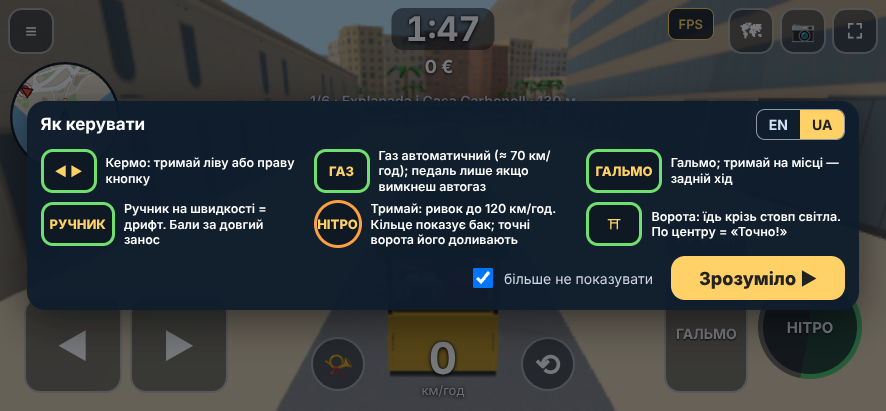
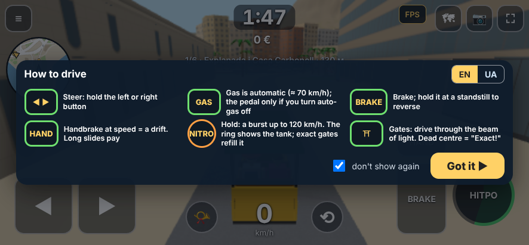
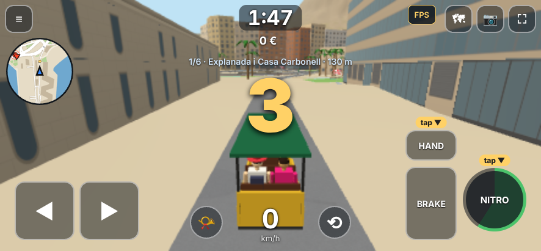
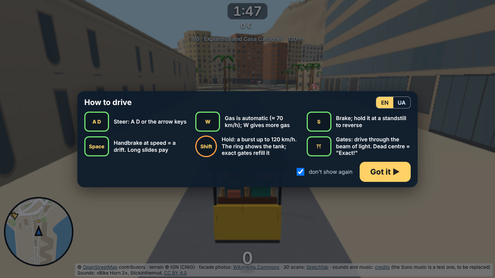
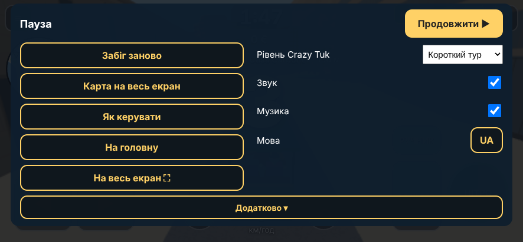
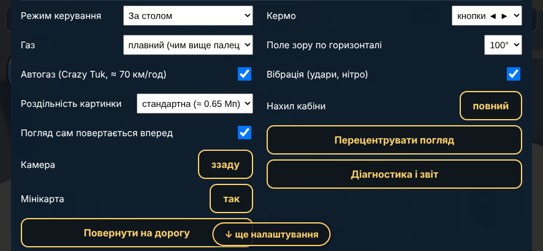
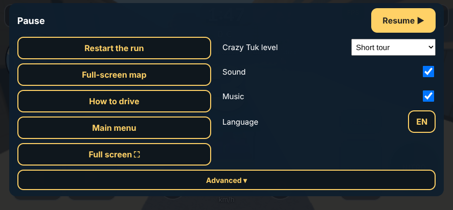
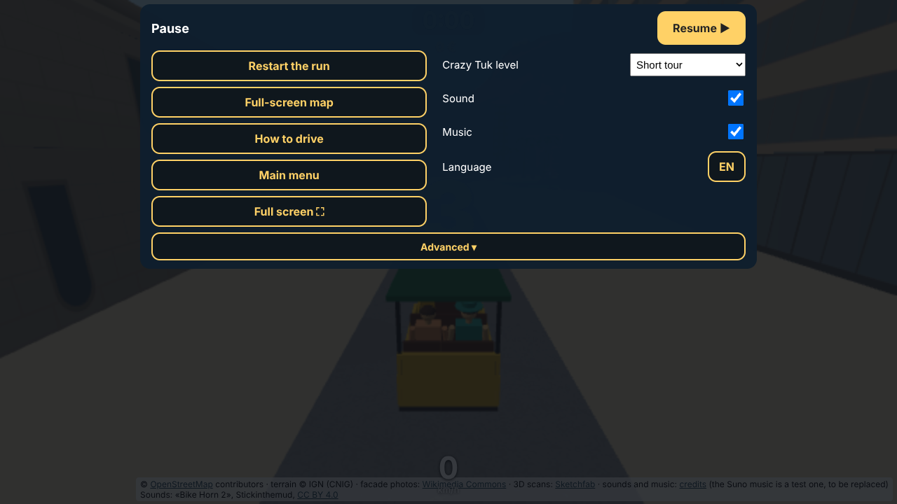
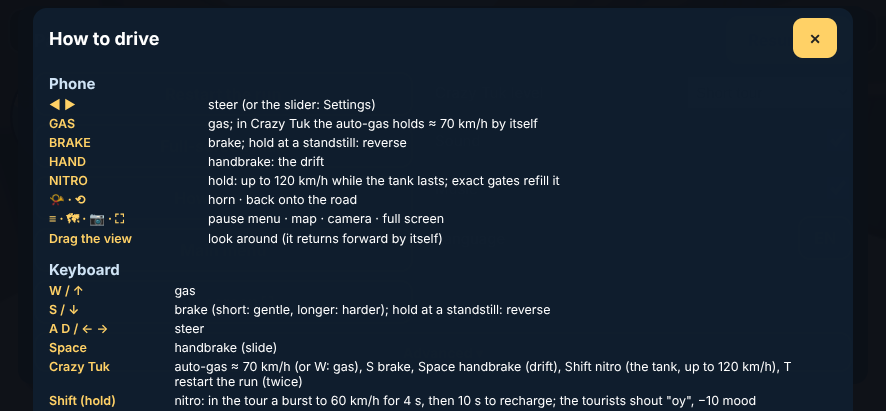

# Crazy Tuk 0.19.2: підказка першого запуску, меню паузи для гостей, чиста адреса

Дата: 2026-10-11. База: 0.19.1. План: `docs/plan-title-screen.md`, розділи 3, 4, 5 (T4, T5, T6).

## Коротко

1. **T4. Підказка першого запуску.** Один раз на пристрої, перед відліком першого забігу Crazy Tuk, за макетом `mock-first-run-hint-uk.png`: шість клітинок (кермо, газ, гальмо, ручник, нітро, ворота), перемикач EN | UA, «більше не показувати» (позначено за замовчуванням), кнопка «Зрозуміло ▶». Відлік 3-2-1 чекає на кнопку. На телефоні піктограми це справжні кнопки екрана, на ПК клавіші (A D, W, S, Пробіл, Shift; Enter теж підтверджує). У VR не показується. Знімеш галочку: підказка зʼявиться знову при наступному забігу. Після «Зрозуміло» перші 20 с над кнопками «НІТРО» і «РУЧНИК» миготять стрілки «тисни ▼»; кожна зникає, щойно ти натиснув свою кнопку.
2. **«Допомога» в грі.** Кнопка в меню паузи відкриває шар з таблицями керування (телефон, клавіатура, Quest) поверх гри. Раніше вона відкривала заставку й телепортувала тук-тук (помилка 0.19.0, знайдена при цій роботі); тепер гра не рухається.
3. **T5. Меню паузи для гостей.** Зверху те, що потрібно гостю: «Продовжити», «Забіг заново», «Карта на весь екран», «Як керувати», «На головну», «На весь екран», вибір рівня, «Звук», «Музика», «Мова». Усе вміщається на екран телефона 411 px без прокрутки. Технічне згорнуте під кнопкою «Додатково ▾»: автогаз, камера, нахил кабіни, мінікарта, поле зору, роздільність, вібрація, «погляд повертається», перецентрувати погляд, повернути на дорогу, діагностика, режим керування, встановити застосунок, редактор і «Звуки» (останні два лише з ключем), подяки й версія. Кнопки «Crazy Tuk» і «Вільна їзда» з меню прибрано: режим міняється через «На головну».
4. **Меню паузи на ПК.** Esc відкриває те саме меню (без рядків лише для телефона), другий Esc закриває, Esc спершу закриває «Допомогу». Раніше Esc вів на заставку: тепер на неї веде «На головну».
5. **T6. Посилання.** Після перезавантаження для обходу кеша `?v=…` прибирається з адресного рядка (інші параметри лишаються): скопійована адреса чиста. Статичні теги Open Graph і Twitter у `index.html` (назва «Crazy Tuk: Alicante», опис англійською, адреса, локаль en з uk як запасною, `summary_large_image`), `<link rel="canonical">`, `<meta name="description">`. Маніфест: назва «Crazy Tuk: Alicante», коротка назва «Crazy Tuk», опис англійською, мова en.
6. **Картинка прев'ю: чекає на твоє «так».** Зроблена, показана тобі в чаті (1200×630, JPEG 85 КБ), але в репозиторії її нема і тега `og:image` теж нема, тож нічого не опубліковано. Коли скажеш «так», додаю файл `assets/og-image.jpg` і два теги `og:image` / `twitter:image` з абсолютною адресою `https://archigreen55-prog.github.io/tuktuk-alicante-vr/assets/og-image.jpg`. Пам'ятай: WhatsApp і Telegram кешують прев'ю за адресою; Telegram можна оновити через @WebpageBot.

## Скріни (емуляція S20 Ultra 886×411)

| | |
|---|---|
|  підказка, UA |  підказка, EN (перемикач у самій підказці) |
|  стрілки «tap» над НІТРО і РУЧНИК, відлік іде |  підказка на ПК (клавіші) |
|  меню: основне |  меню: «Додатково» розкрито |
|  меню, EN |  меню на ПК (Esc) |
|  «Допомога» поверх гри | |

## Перевірки

- Node: `test-i18n` (ключі, підстановки, жодної локальної змінної `t`), `test-sound-bank`, `check-comments`, `test-touch`, `test-level-edit`, `sim-arcade`, `sim-tour`.
- Браузер (програмний рендер, лише логіка й вигляд): нові `t-hint` (підказка раз на пристрої, відлік чекає, EN/UA, галочка, стрілки зникають по кнопках, Enter на ПК не закриває підказку одразу, «Допомога» не рухає тук-тук), `t-menu` (22 рядки видно без прокрутки й 5 схованих під «Додатково» в обох мовах, складання назад, Esc на ПК, «На головну»), `t-link` (`?v=` зникає на актуальній сторінці й лишається на застарілій, теги OG є, `og:image` нема, маніфест); старі тести відкривають гру з `?hint=0`, щоб підказка не блокувала відлік. Регресія: `t-title`, `t-levels`, `t-wave1`, `t-driver`, `t-sound-game`, `t-touch`, `t-desktop`, `t-vr` (IWER), `t-editor`, `t-soundlab`: усе ALL OK. Два тести довелося підправити під нове меню: `t-title` (Esc тепер відкриває меню, на заставку веде «На головну») і `t-soundlab` (кнопка «Звуки» під «Додатково»).

## Що не зроблено або варто знати

- Картинка прев'ю не опублікована (чекаю «так»).
- Коротка адреса й домен (варіанти 2 і 3 з плану) не чіпав: адреса лишається github.io.
- Знайдено й виправлено по дорозі: Enter, що стартував забіг із заставки на ПК, одразу закривав підказку; «Допомога» з меню паузи відкривала заставку.
