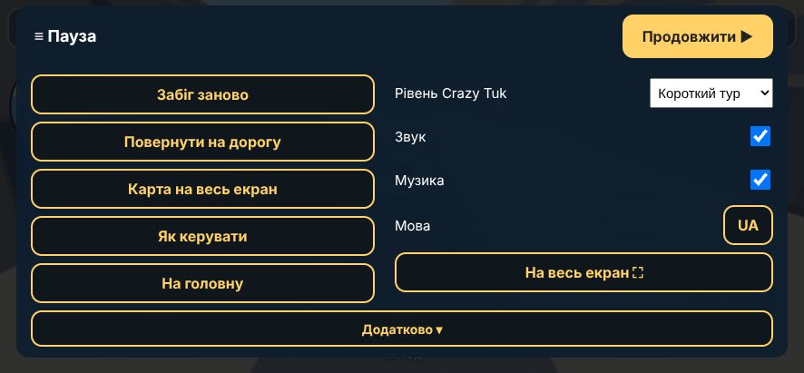
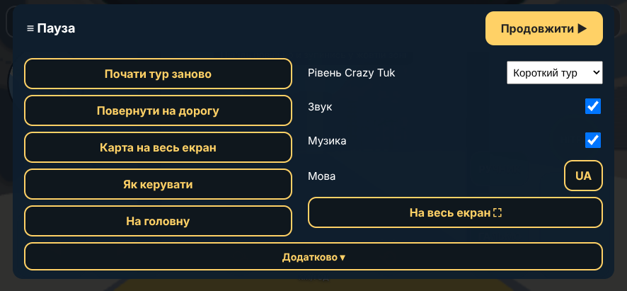
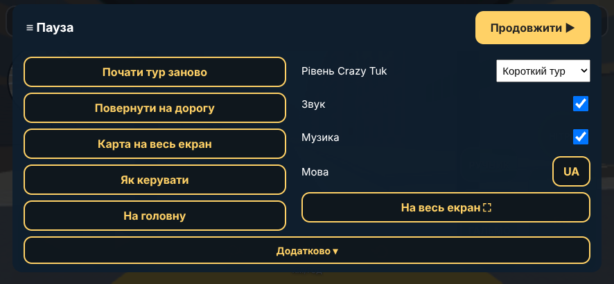

# Crazy Tuk 0.19.3: «Продовжити» у кожному режимі

Дата: 2026-10-11. База: 0.19.2.

## Що сталося

1. **Немає «Продовжити» у Справжньому турі.** У хмарі відтворити не вдалося: у всіх трьох режимах (Crazy Tuk, Справжній тур, Вільна їзда) кнопка була в меню, нічим не закрита, у тому числі в тур-станах «посадка», «картка зупинки», «підсумок» і з фото та моделями. Тому я не стверджую, що знайшов саму причину, а прибрав усе, що могло зробити кнопку недосяжною на реальному телефоні:
   - шапка меню з «Продовжити ▶» тепер **прилипає до верху** і лишається на екрані, коли меню прокручене (раніше після розкриття «Додатково» й прокрутки вона йшла за верх екрана);
   - друга «Продовжити ▶» в кінці списку «Додатково»;
   - заголовок «≡ Пауза» це кнопка, що закриває меню, і стоїть там, де в грі кнопка ≡;
   - тап по затемненню поза карткою закриває меню;
   - кнопка «Назад» телефона і повторний виклик ≡ закривають меню (перевірено);
   - на ПК Esc відкриває й закриває меню, кнопка «Resume» є.
2. **Галочки «Звук» і «Музика» знятими.** Код ніде не скидає їх при зміні режимів: вони пишуться в пам'ять лише коли ти сам клацаєш галочку. Перевірено: за замовчуванням обидві ввімкнені у Справжньому турі, після Вільної їзди, Crazy Tuk і назад; вимкнені тобою лишаються вимкненими крізь усі зміни режиму й перезавантаження. Найімовірніше, галочку зняв випадковий тап поруч (вони стоять під списком рівня; тап по списку й закриття його вікна могли дістати галочки). Щоб не гадати вдруге, у «Діагностика → звіт» у рядку «звук» тепер є `збережено: sound.on=…, music.on=…`: якщо знову побачиш зняті, надішли звіт.

## Тести

`t-menu` розширено: для **Crazy Tuk, Справжнього туру й Вільної їзди на телефоні** (8 перевірок кожен: кнопка видна й закриває; ≡ заголовок; тап поза карткою; «Назад»; перемикання хука ≡; шапка лишається при прокрутці з розкритим «Додатково») і **на ПК** (Esc відкриває, «Resume» видно й закриває, Esc закриває); плюс 4 перевірки звуку й музики крізь зміни режимів і перезавантаження. Усе ALL OK, а також `t-title`, `t-hint`, `t-editor`, `t-soundlab`, `t-wave1`, `t-levels`, `test-i18n`, `check-comments`.

## Скріни меню паузи (емуляція S20 Ultra)

| Crazy Tuk | Справжній тур | Вільна їзда |
|---|---|---|
|  |  |  |

Якщо на твоєму телефоні кнопки все одно не видно, зроби скрін меню й надішли «Діагностика → звіт»: це дасть розмір вікна й що лежить поверх кнопки.
